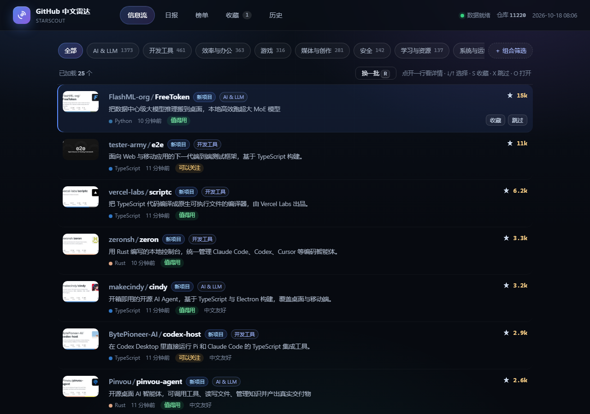

# GitHub Radar · StarScout

[中文](README.md) · [English](README-EN.md)

> A local project-discovery tool: it collects GitHub repos created or updated within the last 90 days, generates Chinese summaries with an LLM, and serves them as a feed you can skim.



## Features

- **Feed**: preview image, owner/repo, one-line Chinese summary, language, time and stars at a glance; click for details
- **Detail & recommendations**: 180–320 character Chinese summary, 2–4 key points, a large preview image and similar projects
- **Daily digest & rankings**: best of the last 24 hours, weekly / monthly star gains, newly indexed and all-time star charts
- **Favorites & history**: write notes on favorites and export them as Markdown; skipped repos can be put back into the feed
- **Taste feedback**: favorite / interested / skip adjust tag weights, so the feed gets closer to your taste
- **Fully local**: SQLite storage, no telemetry; works with DeepSeek, OpenAI, local Ollama or any OpenAI-compatible endpoint

## Download & install (Windows)

Download the single installer from [Releases](https://github.com/haxsd/github-radar/releases/latest):

- `GitHubRadar-Setup-0.6.0.exe`: double-click to install, no admin rights required; Start menu / desktop shortcuts and a system tray icon; uninstall via Settings → Apps.
- Data is stored under `%LOCALAPPDATA%\GitHubRadar\` (database, thumbnail cache, logs, `.env`).

## Quick start (from source)

Requires Python 3.11+, a GitHub token (public read-only is enough) and an API key for an OpenAI-compatible model.

```bash
git clone https://github.com/haxsd/github-radar.git
cd github-radar
python -m venv .venv
.venv\Scripts\activate          # Windows; on macOS / Linux use source .venv/bin/activate
pip install -r requirements.txt
python -m radar.web             # open http://127.0.0.1:8765 and fill in the token + model key under Settings
python -m radar.collect seed    # first run: fetch repos created in the last 90 days
python -m radar.collect wave    # daily: incremental collection
```

No key yet? Run `python -m radar.demo` to load the bundled sample data and browse the UI.

Docker (fill in `.env` first):

```bash
cp .env.example .env && docker compose up -d --build
```

## Commands

```bash
python -m radar.collect seed|wave|update|translate|tag|thumbs
python -m radar.collect clean           # preview suspicious repos; add --apply to hide them
```

On Windows, `collect_bg.bat` (headless collection) and `start_web.bat` can be scheduled with Task Scheduler.

## Documentation

- [docs/design.md](docs/design.md): web UI design tokens and component conventions
- [CONTRIBUTING.md](CONTRIBUTING.md): contribution guidelines
- [packaging/使用说明.txt](packaging/使用说明.txt): desktop app install and usage notes (Chinese)
- [Releases](https://github.com/haxsd/github-radar/releases): versions and downloads

## Data & privacy

Database, cache, logs and configuration all stay on your machine; `.env` and `data/` are gitignored and the app collects no telemetry.

## License

MIT
