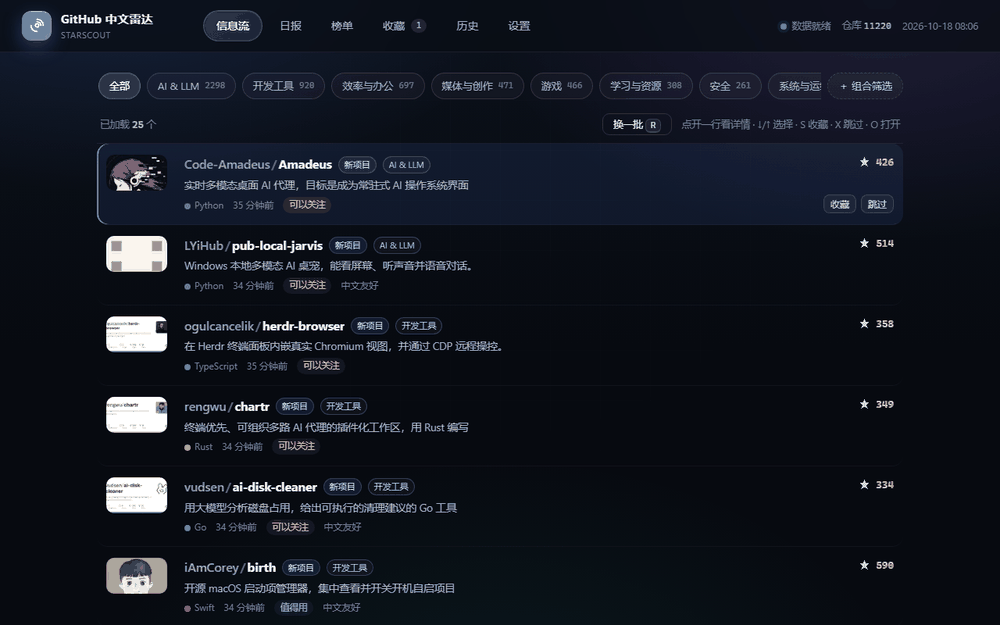
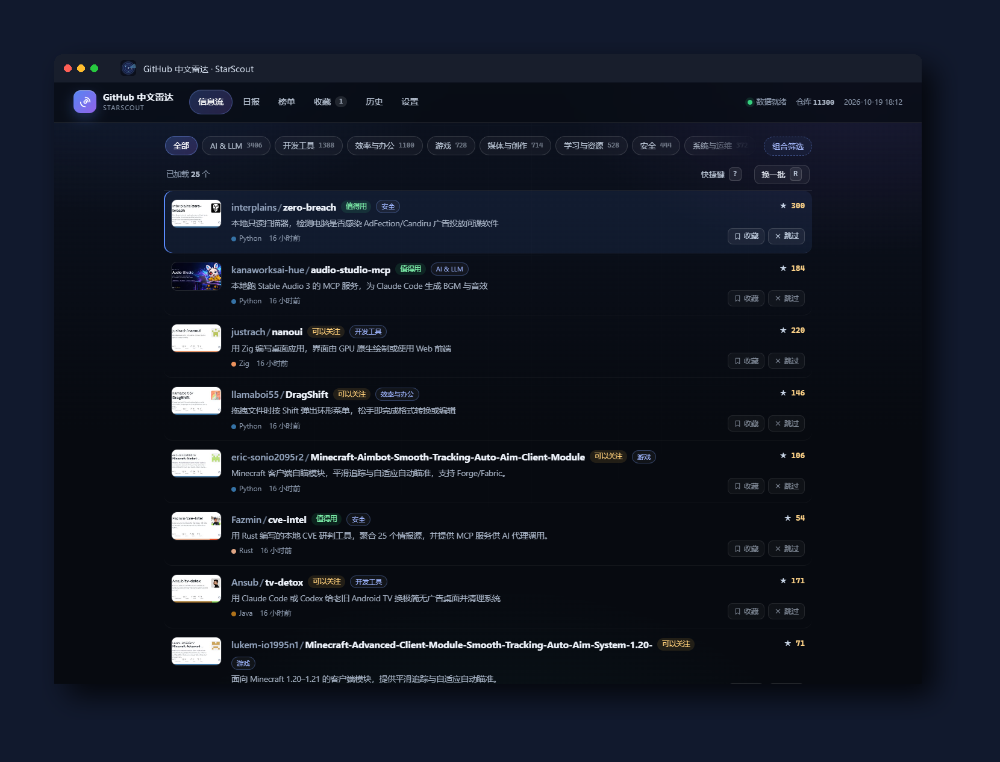
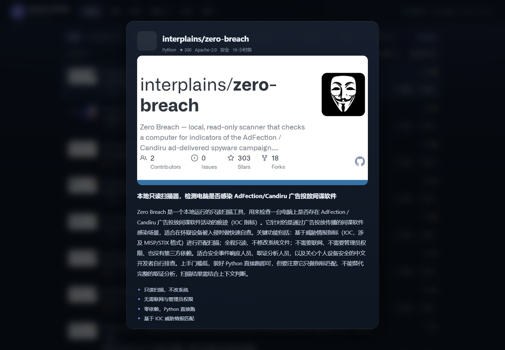
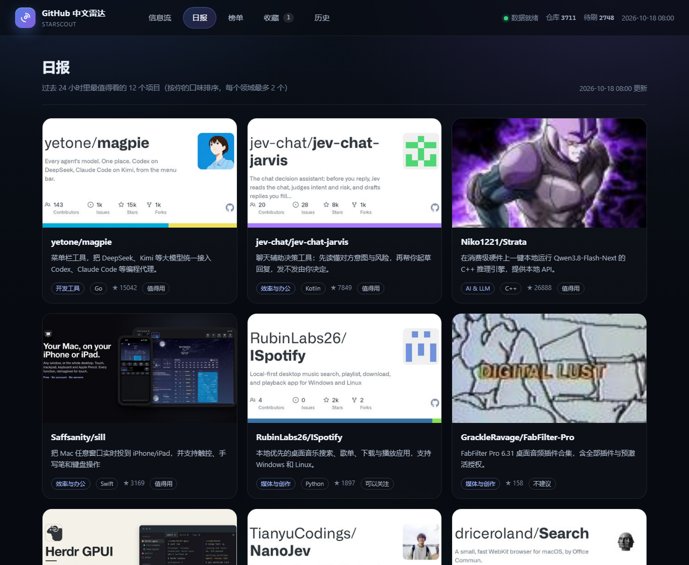
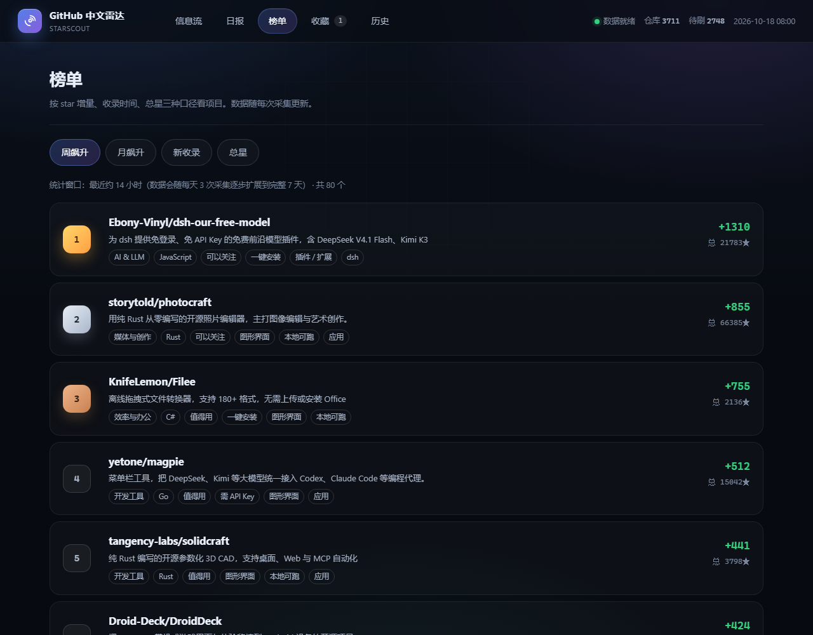
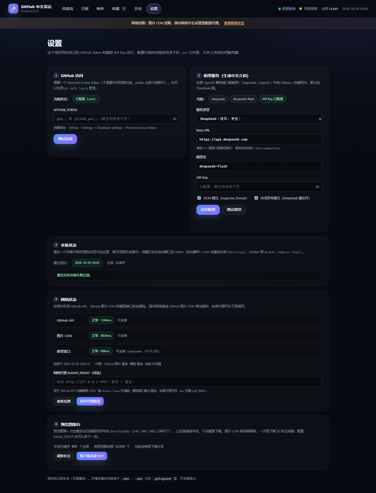

# GitHub 中文雷达 · StarScout

> 把 GitHub 上「最近新建 / 正在更新」的项目自动抓下来，用大模型生成中文介绍，做成一个可以像刷信息流一样快速扫的本地网页。

给自己用的项目发现工具：不用每天翻 Trending，打开就是一批带中文摘要的新项目，收藏 / 跳过会影响后续推荐。





## 四种跑起来的方式

| 方式 | 适合 | 命令 |
|---|---|---|
| **下载 exe** | 不想装 Python | 去 [Releases](https://github.com/haxsd/github-radar/releases) 下 `StarScout-win64.zip`，解压双击 `StarScout.exe` |
| **桌面应用** | 自己电脑上日常用 | `python desktop.py`，或打包成 `StarScout.exe` |
| **网页服务** | 想扔到 NAS / 服务器 | `python -m radar.web` |
| **Docker** | 一条命令部署 | `docker compose up -d --build` |

## 功能

- **列表信息流**：项目预览图、owner/repo、中文一句话、语言、时间、判断徽标、星数；点开看详情
- **详情页**：180~320 字中文摘要 + 2~4 条要点 + 项目预览大图 + **相似项目推荐**
- **日报**：过去 24 小时最值得看的项目，按口味排序，每个领域最多 2 个
- **榜单**：周飙升 / 月飙升 / 新收录 / 总星榜（按 star 快照差值计算）
- **收藏**：可写备注、一键导出 Markdown
- **历史**：看过的、跳过的、收藏的都在；跳过后悔可以放回信息流
- **兴趣反馈**：收藏 / 感兴趣 / 跳过会改变标签权重，越刷越合口味
- **标签组合筛选**：领域 + 形态 + 平台 + 特性多条件 AND
- **桌面应用**：Edge 应用窗口模式，像原生 App 一样双击打开（也可打包成 exe）
- **示例数据**：没配 Key 也能先点开看效果，12 个手写中文示例项目
- **数据清洗**：自动隐藏 SEO 推广页、破解资源、批量刷星农场
- **采集状态可见**：首页顶部红条提示采集失败 + 设置页展示最近一次采集失败原因
- **网络状态可见**：首页顶栏显示网络正常/受限/异常，设置页检测 GitHub API、图片 CDN、模型接口连通性，并支持配置代理
- **预览图本地缓存**：下载一次存本地（240/480/960），支持一键预下载未读卡片，浏览时不再重复请求 CDN
- **全本地**：SQLite 存数据，不收集任何遥测






## 安装（Windows）

推荐从 [Releases](https://github.com/haxsd/github-radar/releases/latest) 下载：

| 版本 | 适合 | 说明 |
|---|---|---|
| **安装版** `GitHubRadar-Setup-0.6.0.exe` | 普通用户 | 双击安装，**不需要管理员权限**；开始菜单/桌面快捷方式；托盘常驻；可在「设置 → 应用」卸载 |
| **便携版** `StarScout-0.6.0-win64.zip` | 放 U 盘 / 不想安装 | 解压后双击 `StarScout.exe`；在程序目录放一个空文件 `portable.flag`，数据就会保存在程序目录 |

安装版的数据默认放在：

```
%LOCALAPPDATA%\GitHubRadar\
  data\radar.db、data\thumbs、data\logs\
  .env
```

卸载时会询问是否删除本地数据；选「否」可保留数据库和预览图缓存。

从旧版绿色目录迁移：把旧目录的 `data` 和 `.env` 复制到上面的数据目录，或运行：

```bat
StarScout.exe --import-data "旧目录路径"
```

## 快速开始（从源码运行）

要求：Python 3.11+，一个 GitHub Token，一个 OpenAI 兼容的模型 API Key（默认 DeepSeek）。

```bash
git clone https://github.com/haxsd/github-radar.git
cd github-radar

# 建虚拟环境
python -m venv .venv
# Windows
.venv\Scripts\activate
# macOS / Linux
source .venv/bin/activate

pip install -r requirements.txt

# 启动网页（第一次还没有数据，先去「设置」配置 key）
python -m radar.web
```

打开 <http://127.0.0.1:8765>，点右上角 **设置**，填入：

1. **GitHub Token**（不需要勾任何权限，public 仓库只读即可；留空则尝试用 `gh auth login` 的登录态）
2. **模型服务**：选择 DeepSeek / OpenAI / Ollama / 自定义，填好 Base URL、模型名、API Key
3. 点「测试连接」「测试模型」确认可用，再点「保存配置」

然后拉一次数据（首次会抓近 90 天的新项目，约 1~2 万条，需要一段时间）：

```bash
python -m radar.collect seed      # 首次种子数据
python -m radar.collect wave      # 日常增量（新项目 + 更新 + 中文补全）
```

再刷新网页就能刷了。

## 桌面应用 / 打包

想当成本地应用用（独立窗口、没有浏览器地址栏）：

```bash
python desktop.py            # 源码运行：Edge 应用窗口 + 托盘
```

Windows 打包（需要先 `pip install pyinstaller`，并且安装 Inno Setup 6/7 才能打安装包）：

```bat
build_app.bat                :: 产物：dist\StarScout\StarScout.exe
build_installer.bat          :: 产物：dist\GitHubRadar-Setup-0.6.0.exe
```

打包后的程序：

- 安装版：程序文件在 `%LOCALAPPDATA%\Programs\GitHubRadar`，数据在 `%LOCALAPPDATA%\GitHubRadar`；
- 便携版：在 exe 同目录放 `portable.flag`，数据放程序目录；
- 托盘菜单：打开界面 / 立即采集 / 打开数据目录 / 退出；
- 关闭窗口不会退出，程序继续在托盘后台运行；
- 无窗口采集（任务计划程序可用）：

```bat
StarScout.exe --collect wave
StarScout.exe --collect thumbs --limit 300
```

## Docker

```bash
cp .env.example .env    # 填 GITHUB_TOKEN / LLM_API_KEY
docker compose up -d --build
# 打开 http://127.0.0.1:8765
```

数据落在宿主机的 `./data`，容器里只跑网页服务（桌面窗口模式不适用于容器）。

> ⚠️ **默认只监听本机，别把端口直接开公网。** `docker-compose.yml` 默认把端口发布到 `127.0.0.1`，只有宿主机自己能访问。
>
> - **想从 NAS / 局域网其他设备访问**：把 compose 里的 `ports` 改成 `"8765:8765"`，同时**必须**在 `.env` 里设置 `WEB_ADMIN_TOKEN`。
> - 没有 `WEB_ADMIN_TOKEN` 时，来自非本机地址的「保存配置 / 测试连接 / 测试模型」接口会返回 **403**，设置页为只读。
> - 项目本身没有登录体系，**不建议**把端口暴露到公网；确实需要请自己加反向代理和鉴权。

## 示例数据（不配 Key 也能看）

```bash
python -m radar.demo          # 载入 12 个手写中文示例项目
python -m radar.demo --reset  # 删掉示例数据
```

也可以直接在首页点「载入示例数据」。

## 配置

两种方式等价：网页「设置」会写回 `.env`（推荐，立即生效），也可以手动改 `.env`。
环境变量优先级高于 `.env`。

| 键 | 说明 | 默认 |
|---|---|---|
| `GITHUB_TOKEN` | GitHub PAT，留空则用 `gh` CLI 登录态 | 空 |
| `LLM_PROVIDER` | `deepseek` / `openai` / `ollama` / `custom` | `deepseek` |
| `LLM_BASE_URL` | OpenAI 兼容接口地址 | `https://api.deepseek.com` |
| `LLM_MODEL` | 模型名 | `deepseek-chat` |
| `LLM_API_KEY` | 模型 API Key（Ollama 可留空） | 空 |
| `LLM_JSON_MODE` | 是否要求 JSON 输出 | `1` |
| `LLM_DISABLE_THINKING` | 关闭思考模式（DeepSeek 建议开） | `1` |
| `WEB_HOST` / `WEB_PORT` | 网页监听地址 | `127.0.0.1` / `8765` |
| `WEB_ADMIN_TOKEN` | 非本机访问时的设置管理口令；留空 = 禁止远程改设置，修改后需重启生效 | 空 |
| `RADAR_PROXY` | GitHub API 与缩略图 CDN 的代理，如 `http://127.0.0.1:7897`；留空 = 直连 | 空 |
| `LLM_PROXY` | 模型接口代理；DeepSeek / 本地 Ollama 一般直连，不建议设置 | 空 |

> 不想用 DeepSeek？也可以用 OpenAI（贵）、本地 Ollama（免费），或者任何兼容 `/chat/completions` 的自建网关。

## 常用命令

```bash
python -m radar.collect seed          # 种子：近 90 天新建项目
python -m radar.collect wave          # 日常：增量收录 + 更新事件 + 中文补全
python -m radar.collect update        # 只刷新已有仓库的 star / 提交状态
python -m radar.collect translate     # 补翻译（可加 --limit 500）
python -m radar.collect tag           # 补标签
python -m radar.collect thumbs        # 预下载预览图到本地缓存（可加 --limit 300）
```python -m radar.collect rewrite       # 重写老卡片
python -m radar.collect clean         # 预览可疑仓库（--apply 才真正隐藏，--unhide 恢复）
python -m radar.web                   # 启动网页
```

## 自动化（可选）

Windows 提供了现成的脚本（任务计划里指向它们即可，全天后台无窗口运行）：

| 脚本 | 用途 |
|---|---|
| `collect_bg.bat` | 无窗口采集，日志写 `data/logs/collect.log` |
| `start_web.bat` | 无窗口启动网页服务 |
| `run_hidden.vbs` | 隐藏窗口启动器（`wscript run_hidden.vbs collect_bg.bat`） |
| `translate_loop.bat` | 分批补翻译（每批 120 条 + 超时保护） |

macOS / Linux 用 cron：

```cron
0 0,8,16 * * * cd /path/to/github-radar && .venv/bin/python -m radar.collect wave >> data/logs/collect.log 2>&1
```

## 项目结构

```
radar/
  config.py      配置（GitHub token、模型服务、规则常量）
  db.py          SQLite 结构与读写
  github.py      GitHub REST / GraphQL
  llm.py         模型调用（中文卡生成 / 翻译 / 打标）
  collect.py     采集与维护命令
  feed.py        推荐排序、筛选、榜单、日报
  demo.py        内置示例数据
  web.py         Flask 网页与 API
  netguard.py    出站图片地址校验 / 缩略图 SSRF 防护
  network.py     网络连通性检测（GitHub / 图片 CDN / 模型接口）
  templates/     页面模板（_macros.html 为共享组件宏）
  static/        CSS / JS 静态资源（设计 token、组件与页面脚本）
desktop.py       桌面入口（托盘 / Edge 应用窗口 / --collect 等 CLI）
packaging/       PyInstaller spec、Inno Setup 安装脚本、版本信息、使用说明
scripts/         图标生成、演示 GIF 生成等工具脚本
assets/          应用图标
tests/           行为测试（CI 运行：python -m unittest discover -s tests -v）
data/            本地数据库、缓存（不提交）
Dockerfile       容器镜像
build_app.bat    打包 exe 脚本
build_installer.bat 打 Windows 安装包脚本
```

采集规则：**star > 50 且最近 3 个月有提交** 的仓库进入池子，采集窗口为近 90 天新建；更新事件展示 release / 涨星 / 提交等活动。

## 参与贡献

欢迎提 issue / PR，具体约定见 [CONTRIBUTING.md](CONTRIBUTING.md)。安全问题请不要开公开 issue。

## 常见问题

- **提示 GitHub 403 / 限流**：没配 token 时只有 60 次/小时，配置后 5000 次/小时。
- **模型报错 401 / 404**：检查 Base URL 是否需要 `/v1`，模型名是否拼对；可以先点设置页「测试模型」。
- **数据存在哪 / 怎么备份**：安装版在 `%LOCALAPPDATA%\GitHubRadar`（数据库、预览图、日志、`.env` 都在这里），直接复制整个目录即可备份；便携版数据在程序目录（有 `portable.flag` 时）。源码运行仍在项目根目录的 `data/` 与 `.env`。
- **怎么卸载**：Windows「设置 → 应用 → GitHub 中文雷达 → 卸载」。卸载时可选择保留本地数据；静默卸载默认保留数据。
- **网页能打开但没有内容**：还没跑采集，或数据还在翻译中；看数据目录下的 `logs/` 日志。
- **预览图是本地缓存**：每个仓库第一次显示时会下载一次预览图，压缩成 240 / 480 / 960 三种尺寸存到 `data/thumbs/`，之后打开页面都直接读本地文件，不会重复联网。新收录卡片还没缓存时，可以用设置页「⑤ 预览图缓存 → 预下载未读卡片」，或运行 `python -m radar.collect thumbs --limit 300`；`collect_bg.bat` 也会在采集后自动补 150 张。缓存目录可以随时删除（会按需重新生成），不删会越用越快。
- **预览图加载慢 / 一直是雷达占位图**：页面不会等图片下载——先显示占位图，真实预览图在后台生成后会自动替换（GitHub 图片 CDN 慢或超时也不会卡住页面）。如果长时间仍是占位图，多半是本机直连 GitHub 图片域名超时，检查网络/代理即可，不影响信息流使用。
- **国内网络 / 需要代理**：GitHub API 通常可直连（可能较慢），但 GitHub 图片 CDN（`opengraph.githubassets.com`）在国内经常超时；DeepSeek、本地 Ollama 一般可直连。需要代理时在 `.env` 或设置页配置 `RADAR_PROXY=http://127.0.0.1:7897`（用于 GitHub API + 图片）；如果模型接口也需要代理，额外设置 `LLM_PROXY`。
- **怎么知道网络是否可用**：首页顶栏有一个小网络指示灯（网络正常 / 网络受限 / 网络异常，悬停可看是哪个服务，点击进设置）；设置页「④ 网络状态」可查看 GitHub API、图片 CDN、模型接口各自的连通性与延迟，并点「重新检测」。
- **公司网络 / 代理环境**：缩略图和模型调用默认直连（避免本机代理排队卡死）；GitHub API 未显式配置代理时会沿用系统 `HTTP_PROXY` / `HTTPS_PROXY` 环境变量。
- **安装时提示“Windows 已保护你的电脑”**：安装包目前没有代码签名，点「更多信息 → 仍要运行」即可；安装不需要管理员权限，装在当前用户目录。
- **设置保存 403 / 设置页只读**：说明当前是从非本机地址访问，且没有配置 `WEB_ADMIN_TOKEN`。在 `.env` 里设置该口令并重启服务，或改回本机 `127.0.0.1` 操作。

## 数据与隐私

所有数据（数据库、缓存、日志、配置）都在本地，仓库里不包含任何密钥。`.env` 与 `data/` 已在 `.gitignore` 中。

## 安全说明

- **默认只监听 127.0.0.1**：网页服务默认只绑本机回环地址，其他机器访问不到。
- **非本机改设置要口令**：从非本机地址写入设置需要配置 `WEB_ADMIN_TOKEN`，留空即拒绝远程修改。
- **反向代理要自己鉴权**：如果在本服务前面套 nginx / caddy 等反向代理，Flask 看到的客户端地址会变成 `127.0.0.1`，本服务的「非本机」判断会失效。请让代理自己做鉴权，并且不要在代理层关掉鉴权后把端口暴露出去（本服务不信任 `X-Forwarded-For`）。
- **缩略图域名白名单**：`radar/netguard.py` 只放行 `github.com` / `githubassets.com` / `githubusercontent.com` 及其子域的 https 图片地址，防止缩略图请求被用来做 SSRF。
- **`.env` 是明文**：配置以明文保存在 `.env`（POSIX 下保存后会自动设为 600 权限），请不要分享 `.env` 和 `data/` 目录。

## License

MIT
